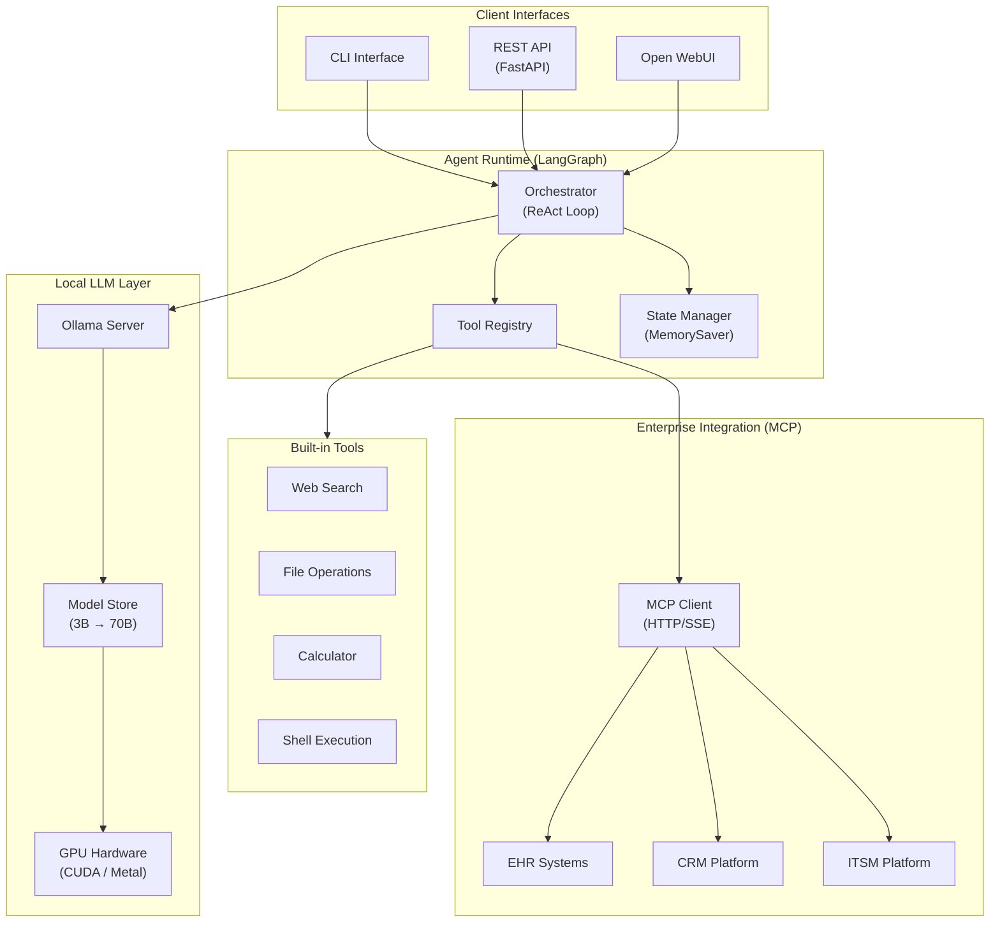
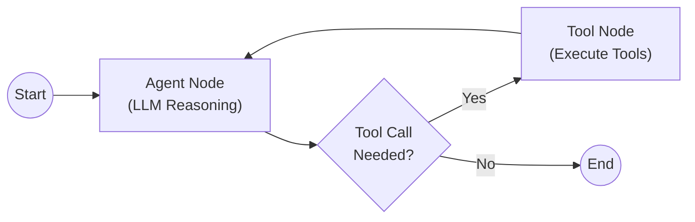
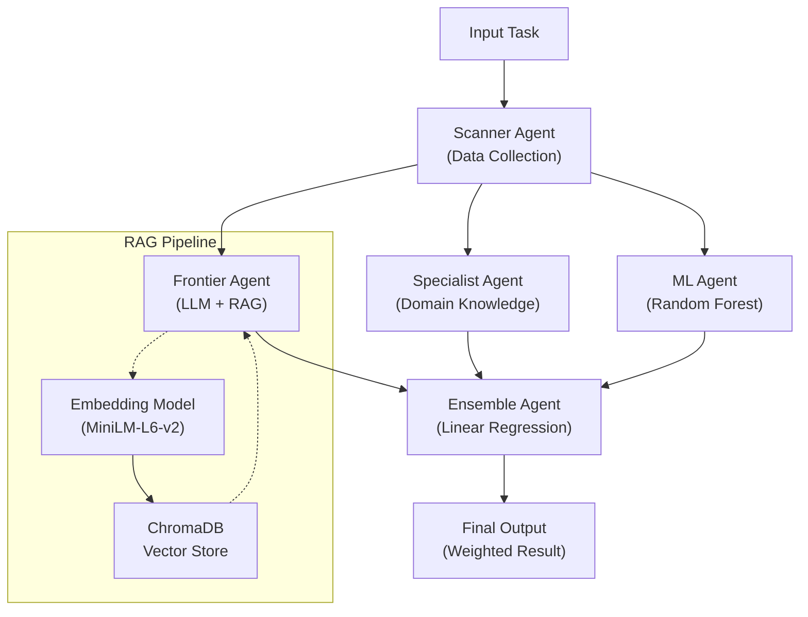

# LLM Agent Orchestration on GPU Infrastructure — Case Study

## Overview

Designed and deployed a production-ready AI agent orchestration stack for local LLM inference on GPU-accelerated hardware. The system enables enterprise organizations to run multi-agent AI workflows entirely on-premises — no third-party LLM API calls, no data leaving the network, no per-token costs after initial hardware investment.

The architecture spans two complementary workstreams: a portable agent runtime built on LangGraph that connects local LLMs to enterprise systems via the Model Context Protocol (MCP), and a multi-agent ensemble system that orchestrates specialized agents (domain experts, ML models, and frontier LLMs) to collaboratively solve complex tasks. Both deploy across local development machines, containerized environments, and GPU-equipped AI Pod infrastructure using a single codebase.

At full deployment, the stack supports 5+ concurrent models in VRAM, 16 parallel inference requests, 8K-token context windows, and dynamic tool integration with enterprise platforms — all running on local GPU hardware with no external API dependencies for core inference.

---

## The Problem

Enterprise AI adoption faces a fundamental tension: the most capable LLMs require sending data to third-party cloud providers, but enterprise data governance policies often prohibit exactly that. Healthcare records, customer PII, financial data, and internal business logic cannot leave the corporate network for many organizations.

The specific challenges were:

1. **Data sovereignty** — Regulated industries (healthcare, financial services) require that sensitive data never leave the organization's infrastructure. Cloud LLM APIs are a non-starter for these workloads.
2. **Latency and availability** — Cloud API calls introduce network latency and create a dependency on external service availability. Agentic workflows that chain multiple LLM calls amplify both problems.
3. **Cost at scale** — Per-token pricing for cloud LLMs becomes significant at enterprise scale. Thousands of agent interactions per day across multiple departments creates unpredictable and growing costs.
4. **Tool integration** — AI agents need to interact with enterprise systems (ITSM, CRM, EHR). The agent runtime must support dynamic tool discovery and execution against these platforms, not just text generation.
5. **Model flexibility** — No single model fits all use cases. The infrastructure needed to support rapid model evaluation, size/quality trade-off analysis, and seamless model swapping without application changes.

What was needed was a full-stack agent platform — from GPU hardware to agent orchestration to enterprise tool integration — that runs entirely within the organization's infrastructure boundary.

---

## Architecture

### System Design

### Components

| Component | Role | Key Consideration |
|---|---|---|
| **Ollama** | Local LLM inference server | Model management, GPU memory allocation, parallel request handling |
| **LangGraph Agent** | ReAct reasoning loop with tool use | State persistence across turns, iteration limits, streaming support |
| **FastAPI Server** | REST API for agent interaction | Dual agent modes (simple chat vs full tool-use), health monitoring |
| **MCP Client** | Enterprise system integration | JSON-RPC 2.0 over HTTP/SSE, per-server authentication, tool discovery |
| **Tool Registry** | Built-in + dynamic MCP tools | Configuration-driven availability, security controls per tool |
| **Open WebUI** | Browser-based chat interface | Direct Ollama integration for ad-hoc queries |
| **CLI** | Command-line agent interface | Interactive sessions, conversation history, model selection |
| **GPU Hardware** | CUDA/Metal inference acceleration | Flash attention, model parallelism, VRAM management |

### Multi-Agent Design

The system implements two distinct multi-agent patterns for different use cases:

#### Pattern 1: Tool-Augmented Single Agent (Production)

The production agent uses a ReAct (Reasoning + Acting) loop implemented as a LangGraph `StateGraph`:

- **State management**: Custom `AgentState` TypedDict preserving message history, iteration count, and final answer across reasoning steps
- **Thread-based memory**: `MemorySaver` checkpointer enables multi-turn conversations with `thread_id` isolation
- **Iteration limits**: Configurable maximum reasoning steps (default: 10) prevents runaway loops
- **Tool dispatch**: Agent decides which tools to invoke based on the reasoning context; tools execute and return results to the next reasoning step

#### Pattern 2: Ensemble Agent Orchestration (Benchmarking)

The benchmarking workstream implements a multi-agent ensemble where specialized agents collaborate:

- **Agent specialization**: Each agent handles a specific approach — domain heuristics, LLM reasoning with RAG context, or ML model inference
- **Parallel estimation**: All three agents produce independent results from the same input
- **Ensemble combination**: A meta-agent uses linear regression to weight and combine individual agent outputs
- **RAG integration**: The frontier agent augments LLM reasoning with vector-similarity search over a domain knowledge base (ChromaDB + sentence-transformers)
- **Sequential pipeline**: Scanner agent collects data, then hands off a shared memory structure to downstream agents

### Context Passing Protocol

Agent-to-agent context is preserved through:

1. **Shared state objects** — Agents receive and mutate a common data structure (list of opportunities, accumulated results)
2. **LangGraph message history** — The ReAct agent maintains full message history (including tool calls and results) via the `add_messages` reducer
3. **Thread isolation** — Each conversation thread maintains independent state via `MemorySaver` with unique `thread_id` keys
4. **Graceful handoff** — Agents inherit from a common base class with standardized input/output contracts and colored logging for observability

---

## Benchmarking

### Methodology

Model evaluation was conducted across multiple dimensions to identify the right model-size-to-quality trade-off for enterprise agent workloads:

| Dimension | How Measured |
|---|---|
| **Inference latency** | Time-to-first-token and total generation time per request |
| **Throughput** | Parallel request handling under concurrent load |
| **Quality** | Task completion accuracy for tool-use, reasoning, and multi-step workflows |
| **VRAM utilization** | Peak memory consumption during inference |
| **Context handling** | Performance degradation at increasing context lengths (2K → 8K tokens) |

### Results by Model Size

| Model | Parameters | VRAM Required | Best For | Trade-off |
|---|---|---|---|---|
| `llama3.2:3b` | 3B | 2 GB | Fast iteration, simple queries | Limited reasoning depth |
| `qwen2.5:7b` | 7B | 5 GB | Balanced quality/speed | Good tool-use, moderate latency |
| `qwen2.5:14b` | 14B | 9 GB | High-quality reasoning | Slower, needs mid-range GPU |
| `qwen2.5:32b` | 32B | 20 GB | Complex multi-step tasks | Requires dedicated GPU |
| `llama3.3:70b` | 70B | 40 GB | Maximum capability | Requires enterprise GPU (A100/H100) |

### Recommendations

- **Development/prototyping**: 3B models (sub-second response, adequate for testing tool integration)
- **Production agent workloads**: 7B–14B models (best quality-to-latency ratio for enterprise use cases)
- **Complex reasoning tasks**: 32B+ models (when accuracy is more important than response time)
- **Model selection is workload-dependent**: A simple lookup agent needs 3B; a clinical triage agent benefits from 14B+

---

## Design Decisions

### 1. Local LLM Deployment vs Cloud APIs

**Decision:** All core inference runs locally via Ollama. No cloud LLM API dependency for production workloads.

**Why:** Data sovereignty was non-negotiable for the target use cases (healthcare, financial services). Local deployment also eliminates per-token costs and external availability dependencies.

**Trade-off:** Requires GPU hardware investment and operational overhead for model management. Frontier cloud models have higher ceiling quality. Mitigated by supporting cloud models as an optional path for non-sensitive workloads in the benchmarking system.

### 2. LangGraph for Agent Orchestration

**Decision:** LangGraph `StateGraph` over raw LangChain agents or custom orchestration.

**Why:** LangGraph provides built-in state persistence (MemorySaver), graph-based control flow (conditional edges), and streaming support. The ReAct pattern maps naturally to a two-node graph (agent → tools → agent). Custom orchestration would have required reimplementing all of these.

**Trade-off:** LangGraph adds a framework dependency. Accepted because the alternative — hand-rolling state management, checkpointing, and streaming — would have been significantly more engineering effort with no clear benefit.

### 3. MCP for Enterprise Tool Integration

**Decision:** Model Context Protocol (MCP) over custom REST wrappers or function-calling adapters.

**Why:** MCP provides a standardized protocol for tool discovery and execution. The existing enterprise MCP server ecosystem (10+ servers) was already deployed. Building an MCP client into the agent runtime gives immediate access to 150+ enterprise tools without any per-platform integration work.

**Trade-off:** MCP adds a protocol layer (JSON-RPC over HTTP/SSE) between the agent and enterprise APIs. Direct REST calls would have lower latency. Accepted because the tool discovery and schema validation provided by MCP eliminates the need to hard-code tool definitions per platform.

### 4. Multi-Agent Ensemble vs Single Agent

**Decision:** Ensemble pattern for benchmarking (multiple specialized agents); single ReAct agent for production.

**Why:** The ensemble pattern demonstrates that combining multiple approaches (domain knowledge, LLM reasoning, ML models) produces better results than any single approach. However, production workloads prioritize latency and simplicity — a single agent with rich tool access is more practical for real-time interactions.

**Trade-off:** The production agent doesn't benefit from ensemble diversity. Mitigated by making the tool registry extensible — the single agent can be augmented with specialized tools rather than specialized sub-agents.

### 5. Three-Mode Deployment (Local / Container / GPU Pod)

**Decision:** Single codebase deployable natively (local dev), in containers (Podman/Docker), or on GPU-equipped AI Pods (Kubernetes/OpenShift).

**Why:** Development iteration needs fast local startup. Staging needs reproducible container environments. Production needs GPU scheduling and horizontal scaling. Supporting all three from one codebase with environment-specific compose files eliminates divergence between environments.

**Trade-off:** Three docker-compose variants (base, GPU, macOS) to maintain. Accepted because the alternative — separate codebases or Dockerfiles per environment — would create drift.

### 6. Ollama as the LLM Runtime

**Decision:** Ollama over vLLM, llama.cpp, or TensorRT-LLM.

**Why:** Ollama provides the best developer experience — single binary, model management CLI, OpenAI-compatible API, and native support for Apple Metal (development) and CUDA (production). Model swapping is a single command, not a configuration change.

**Trade-off:** Ollama has lower raw throughput than vLLM for high-concurrency production workloads. Accepted because the target scale (16 parallel requests) is within Ollama's capability, and the operational simplicity significantly reduces deployment friction.

---

## Technical Patterns

Detailed design patterns with sanitized pseudocode are documented in the [`/patterns/`](patterns/) directory:

| Pattern | Description |
|---|---|
| [Agent Architecture](patterns/agent-architecture.md) | ReAct loop, state management, and conversation memory |
| [Tool Integration](patterns/tool-integration.md) | Built-in tools, MCP client, and dynamic tool discovery |
| [Deployment](patterns/deployment.md) | Local, container, and GPU deployment configurations |
| [Ensemble Orchestration](patterns/ensemble-orchestration.md) | Multi-agent collaboration with weighted combination |

---

## Technical Stack

| Layer | Technology |
|---|---|
| **Language** | Python 3.11+ |
| **Agent Framework** | LangGraph, LangChain |
| **LLM Runtime** | Ollama (CUDA + Metal) |
| **API Framework** | FastAPI (Uvicorn) |
| **Enterprise Integration** | Model Context Protocol (MCP) — JSON-RPC 2.0 over HTTP/SSE |
| **Vector Database** | ChromaDB (RAG pipeline) |
| **Embeddings** | sentence-transformers (MiniLM-L6-v2) |
| **ML Models** | scikit-learn (Random Forest, Linear Regression) |
| **Containerization** | Docker / Podman (multi-service compose) |
| **GPU Access** | NVIDIA CDI (Container Device Interface) |
| **Orchestration** | Kubernetes / OpenShift with HPA |
| **Web Interface** | Open WebUI |
| **Configuration** | Pydantic BaseSettings + environment variables |
| **CLI** | Custom Python CLI with rich terminal output |

---

## Impact

- **Full data sovereignty** — All inference runs on local GPU hardware. Zero data leaves the organization's network for core AI workloads.
- **5 model sizes benchmarked** (3B → 70B) with documented quality/latency/VRAM trade-offs, enabling informed model selection per use case
- **150+ enterprise tools** accessible via MCP integration — agents interact with ITSM, CRM, EHR, and custom platforms without per-platform code
- **3 deployment modes** from a single codebase — local development, containerized staging, and GPU-accelerated production
- **16 parallel inference requests** supported on GPU hardware with flash attention optimization
- **Sub-second response times** on 3B–7B models for simple agent interactions; acceptable latency on 14B for complex reasoning
- **Ensemble agent system** demonstrated that combining domain knowledge, LLM reasoning, and ML models outperforms any single approach
- Validated as a reference architecture for enterprise BYOLLM (Bring Your Own LLM) deployments across multiple business units

---

## Lessons Learned

### 1. Model Size Is a Spectrum, Not a Binary Choice
The assumption going in was that bigger models are always better. Benchmarking proved otherwise — for tool-use workloads (agent deciding which MCP tool to call), 7B models performed nearly as well as 70B models at 8x the speed. The key insight: match model size to task complexity, not to general capability benchmarks.

### 2. GPU Memory Management Is the Real Bottleneck
VRAM, not compute, is the limiting resource for local LLM deployment. Running multiple models simultaneously for A/B testing or ensemble inference requires careful VRAM budgeting. Ollama's `OLLAMA_MAX_LOADED_MODELS` and `OLLAMA_KEEP_ALIVE` settings were critical tuning points. Flash attention (`OLLAMA_FLASH_ATTENTION=1`) reduced memory pressure by approximately 2x for long-context queries.

### 3. MCP Eliminates the Tool Integration Tax
Without MCP, every enterprise platform would have required a custom tool adapter — defining schemas, handling auth, parsing responses. The MCP client integration gave the agent access to the entire enterprise tool ecosystem (150+ tools across 10+ platforms) through a single protocol implementation. The engineering cost of supporting a new platform dropped from days to zero (assuming an MCP server exists for that platform).

### 4. Container Parity Matters More Than You Think
The most painful debugging sessions came from differences between local (macOS Metal) and container (Linux CUDA) environments. Investing in docker-compose variants per environment (base, GPU, macOS) and testing the full workflow in containers early — not just at deployment time — eliminated an entire class of "works on my machine" issues.

### 5. Ensemble Agents Are Powerful but Operationally Complex
The multi-agent ensemble produced the highest-quality results, but the operational complexity (running three agents + a combiner, managing shared state, debugging disagreements between agents) is significant. For production, the single ReAct agent with rich tools was the pragmatic choice. Ensemble patterns are best reserved for batch processing or offline analysis where latency tolerance is higher.
