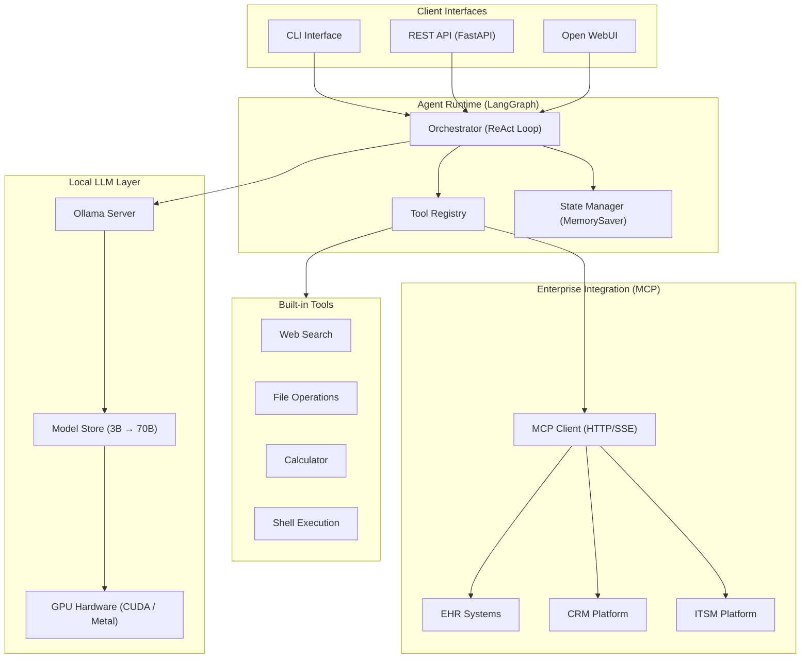
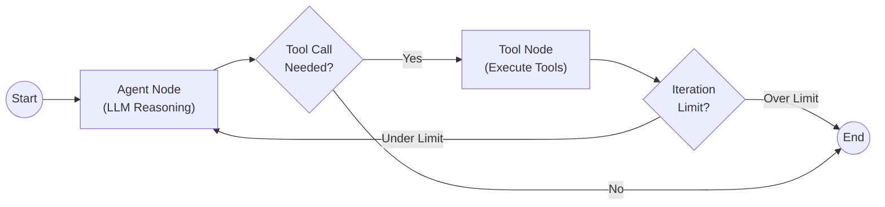
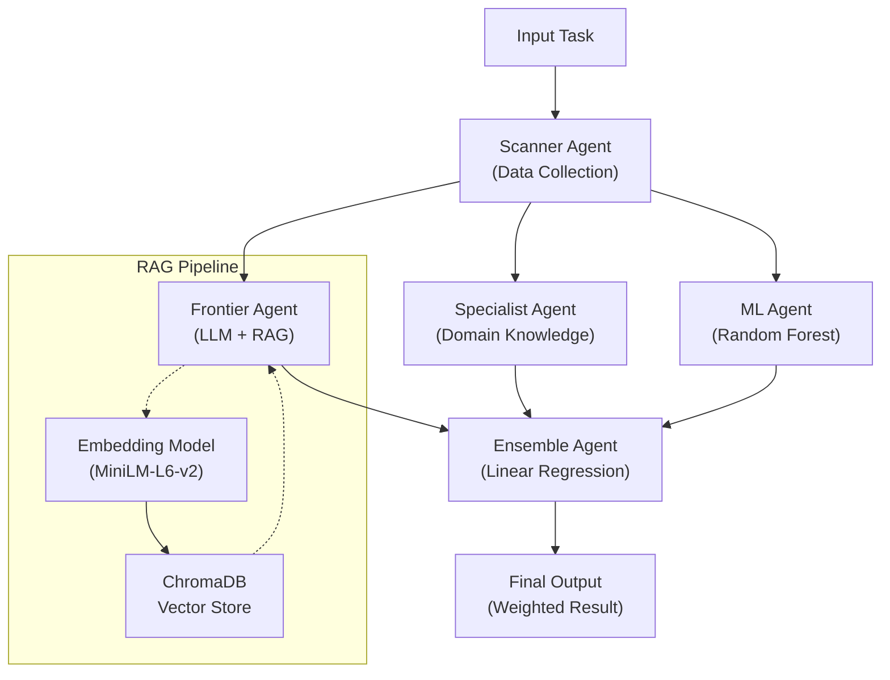
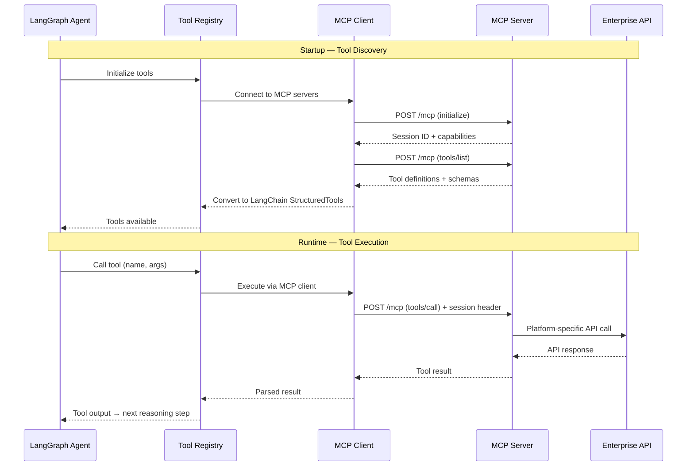
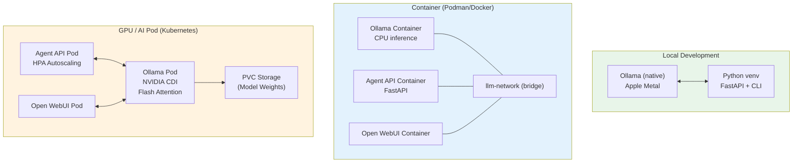

# Architecture Diagrams — LLM Agent Orchestration

## 1. High-Level System Architecture

The full system spans four layers: client interfaces, agent runtime, local LLM inference, and enterprise tool integration.

## 2. ReAct Agent Loop

The production agent follows the ReAct (Reasoning + Acting) pattern implemented as a LangGraph StateGraph with two nodes and a conditional edge.

**State management**: The `AgentState` TypedDict carries `messages` (full conversation with tool results), `iteration_count` (loop counter), and `final_answer` across all nodes. The `add_messages` reducer appends new messages rather than replacing them.

**Iteration safety**: A configurable maximum (default: 10) prevents runaway reasoning loops. If the agent exceeds the limit, the loop terminates and returns the last available response.

## 3. Multi-Agent Ensemble Flow

The benchmarking system orchestrates multiple specialized agents to produce a weighted ensemble result.

**Agent roles**:
- **Scanner**: Collects input data from external sources (RSS feeds, web scraping)
- **Specialist**: Applies domain-specific heuristics and knowledge rules
- **Frontier**: Uses LLM reasoning augmented with RAG (ChromaDB vector search over domain knowledge base)
- **ML Agent**: Runs a trained Random Forest model for structured prediction
- **Ensemble**: Combines all three outputs using Linear Regression to produce a weighted final result

## 4. MCP Tool Integration Flow

Enterprise systems are accessed through the Model Context Protocol (MCP) via an HTTP/SSE client that handles tool discovery, authentication, and execution.

## 5. Deployment Topology

Three deployment modes from a single codebase, using environment-specific docker-compose overrides.

## 6. Model Size vs Capability Matrix

| Model | VRAM | Latency | Tool-Use Quality | Reasoning | Recommended For |
|---|---|---|---|---|---|
| 3B | 2 GB | <1s | Adequate | Basic | Development, testing |
| 7B | 5 GB | 1-2s | Good | Moderate | Production agent (standard) |
| 14B | 9 GB | 2-4s | Strong | Good | Production agent (complex) |
| 32B | 20 GB | 4-8s | Excellent | Strong | Batch processing, analysis |
| 70B | 40 GB | 8-15s | Excellent | Excellent | Maximum quality (offline) |
